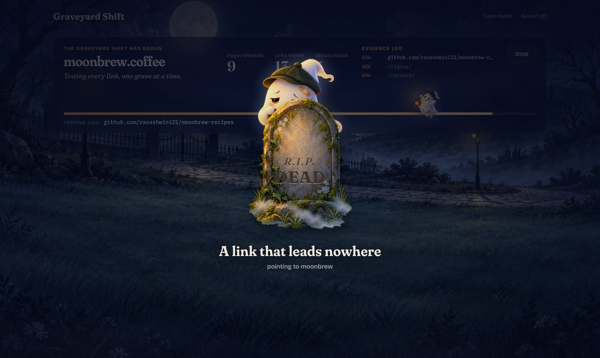
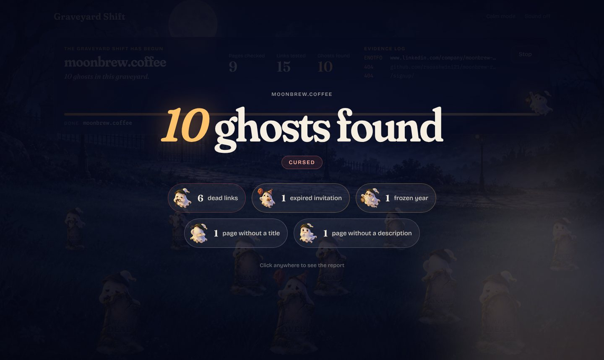
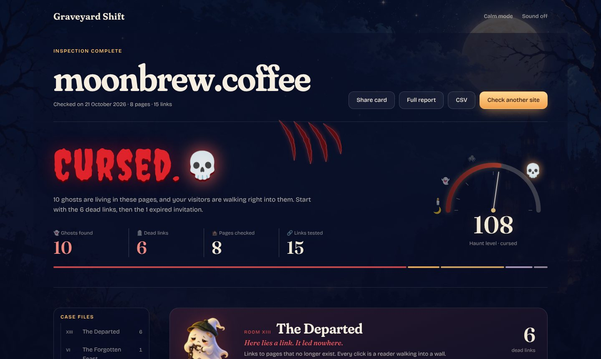
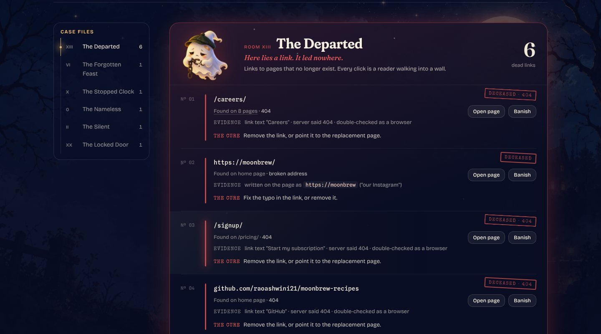
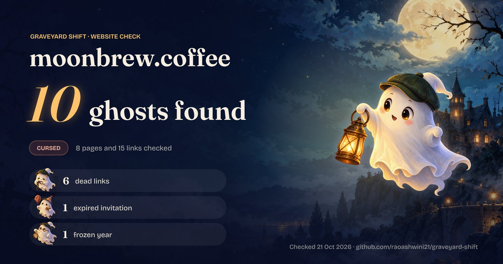
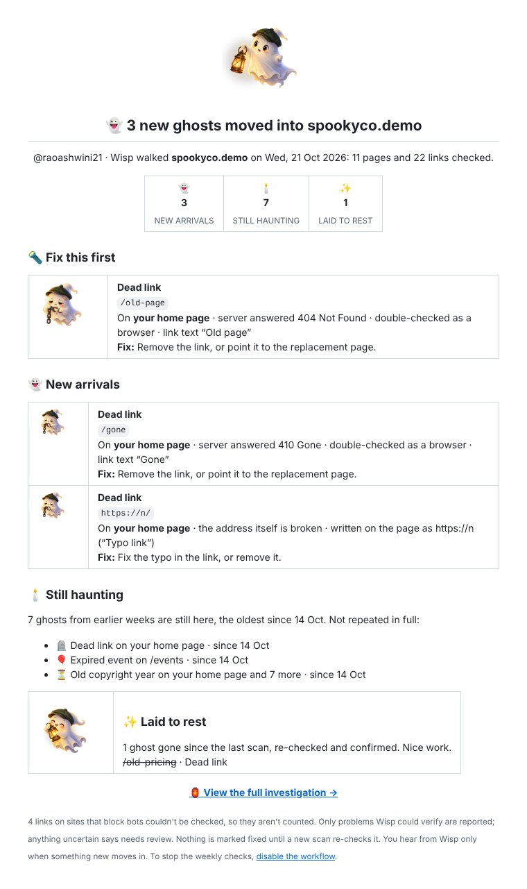

<p align="center">
  
</p>

<h1 align="center">Graveyard Shift</h1>

<p align="center"><b>Your website is haunted.</b> Paste your site and Wisp walks every page, tests every link,<br>
and shows you exactly what's quietly broken and how to fix it.</p>

<p align="center">Free · open source · no sign-up · no API keys</p>

<!-- DEMO VIDEO: replace this comment with the line below, using your link
<p align="center"><b>▶️ <a href="VIDEO_LINK_HERE">Watch the 2-minute demo</a></b></p>
-->

## Check your own site in 2 minutes

You need [Node.js](https://nodejs.org) 20 or newer. Then:

```bash
git clone https://github.com/raoashwini21/graveyard-shift.git
cd graveyard-shift
npm install
npm start
```

Open **http://localhost:3000**, paste your website, and watch Wisp go to work. <br>Want him to keep checking every week, with nothing to install? [Hire the night watchman](#hire-the-night-watchman).


## What it finds

Every website collects ghosts. Each one costs you clicks, trust or search rankings.

| | Ghost | What it means |
| :-: | --- | --- |
|  | **Dead links** | Links to pages that no longer exist. Every click is a reader walking into a wall. |
|  | **Hijacked links** | Links to one company that now land on another. The tool you recommended was bought, renamed or shut down. |
|  | **Expired events** | Webinars and meetups whose date has passed, still inviting people in. |
|  | **Frozen years** | A copyright stuck in an old year. Small, but it makes the whole site look abandoned. |
|  | **Pages without a title** | Search results and browser tabs have nothing to call them. |
|  | **Redirect chains** | Links that bounce through several redirects before arriving. Slower for readers, weaker for search. |
|  | **Pages without a description** | Search engines will write one for you, and you won't like it. |

Every finding comes with the page it's on and the fix. Link problems also show the evidence: the link text and what the server answered.

## How it looks

**The search.** Wisp patrols the graveyard while the scan runs, riding the progress bar. Every real problem the scanner finds rises as a tombstone and tells you, in plain words, what it is.



**The reveal.** The count, the verdict, and every ghost flying out of the graveyard at you.



**The investigation.** A verdict and a haunt level for the whole site, then a case file for each kind of ghost.





Fixed something? **Banish** it. The ghost dissolves, the record stays, and the next scan checks it really stayed gone. You can also download a **share card** for LinkedIn or X, the **full report** as Markdown and a **CSV**.



There's sound (switch it off in the header) and a **Calm mode** that turns off the motion. It also turns on by itself if your device is set to reduce motion.

*Screenshots show [Moonbrew Coffee Co.](docs/), a pretend coffee shop in this repo with ghosts planted on purpose.*

## Run it

You need [Node.js](https://nodejs.org) 20 or newer. Runs on Mac, Windows and Linux.

```bash
git clone https://github.com/raoashwini21/graveyard-shift.git
cd graveyard-shift
npm install
npm start
```

Then open **http://localhost:3000** and paste a website.

Everything runs on your own computer. The only requests it makes are to the site you're checking and the links on it.

### From the terminal

```bash
npm run scan -- yoursite.com
npm run scan -- yoursite.com --max-pages 300
npm run scan -- yoursite.com --format md --out report.md
```

Options: `--max-pages`, `--max-links`, `--internal-only`, `--show-locked`, `--format text|md|json|csv`, `--out`, `--state prev.json` (compare with a previous JSON result: shows what's new and what's gone, and with `--fail-on-ghosts` fails only on new ghosts), `--fail-on-ghosts` (for CI), `--ignore`. Run `npm run scan -- --help` for details.

## Hire the night watchman

Wisp can check one website for you every week, on GitHub, for free. He only speaks up when something new breaks.

1. **Make the file.** In any GitHub repository (a new empty one is fine), click **Add file → Create new file** and name it `.github/workflows/haunt.yml`. Typing the slashes creates the folders.
2. **Paste this in**, change `yoursite.com` to your website, and click **Commit changes**.

   ```yaml
   name: Weekly haunt
   on:
     schedule:
       - cron: '17 3 * * 1'   # Mondays
     workflow_dispatch:
   permissions:
     issues: write
   jobs:
     haunt:
       runs-on: ubuntu-latest
       steps:
         - uses: raoashwini21/graveyard-shift@main
           with:
             site: yoursite.com
   ```
3. **See it now.** Open the **Actions** tab, pick **Weekly haunt** and click **Run workflow**. In a few minutes an issue appears with everything Wisp found, and GitHub emails you.
4. **That's it.** Every Monday he walks your site again. A new ghost? He adds it to the issue and GitHub emails you a card like this one. Nothing new? Silence.

<p align="center"></p>

The card shows what's new, what's still haunting, what was laid to rest, and the one thing to fix first (problems on pricing, signup, demo and contact pages come first). A ghost is only marked laid to rest after a new scan re-checks its page.

Optional settings under `with:`: `max-pages` (default 100), `internal-only: 'true'` to skip links to other sites, and `mention` to choose who gets @mentioned (defaults to the repo owner, `none` to turn it off).

To stop, delete the file or disable the workflow in the Actions tab. In a public repository with no activity for 60 days, GitHub pauses scheduled workflows; one click in the Actions tab turns it back on. Public repositories run Actions for free; private ones use a few of the 2,000 free minutes each month.

## How it stays accurate

A link checker is only useful if you can trust it, so Graveyard Shift would rather say "couldn't check" than cry wolf.

- **A link is only called dead** when the server says 404 or 410, the domain no longer exists, or the address itself is broken (like `https://n`). Every 404 is checked a second time the way a normal browser would ask, because some sites show bots an error and people the real page.
- **Never called dead:** 401, 403, 429, bot challenges, timeouts, refused or reset connections and certificate errors. These are listed separately as **locked doors**: sites that wouldn't let us check. Social sites (LinkedIn, X, Facebook, Instagram and others) are always locked doors, never dead.
- **Server errors** (500, 502) are reported but labelled **needs review**, because they're often temporary. Busy servers (503 and Cloudflare's 52x errors) are locked doors.
- **Hijacked links** ignore normal moves like http to https, adding www, short links and login pages, and a company keeping its name on a new domain.
- **Expired events** are labelled needs review, since a date near a "Register" button isn't always an invitation.
- **It's polite:** it respects robots.txt, waits between requests to the same site, and identifies itself as `GraveyardShift` (except for the browser-style double-check of a link that looked dead).

## Tests

```bash
npm test
```

The tests run a small haunted website locally, with planted ghosts and look-alikes that must not be flagged: pages that show bots a 404 but people the real page, bot challenges, rate limits, busy servers, past events next to future ones, and more. They also cover the weekly watch's logic, using a pretend GitHub.

## Credits

- Built by [Ashwini Rao](https://github.com/raoashwini21) for [Hackyard Yard #5: Haunted](https://hackyard.tech), with Claude.
- Wisp, the spirits and the painted backgrounds were generated for this project.
- Fonts (SIL Open Font License): Fraunces, Bricolage Grotesque, Spline Sans Mono, Special Elite, Eater and Creepster.
- Sound effects are synthesised from scratch by [`tools/make-sounds.py`](tools/make-sounds.py).

## License

MIT
